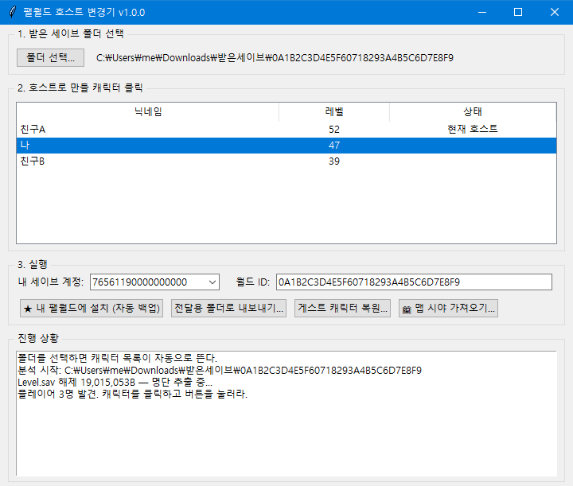

# 팰월드 호스트 변경기 (Palworld Host Changer)

멀티(co-op, 초대 코드)로 하던 월드의 **호스트를 다른 사람으로 바꾸는** Windows 도구.
친구가 서버(월드)를 못 열어줄 때, 그 월드를 **내 캐릭터로** 이어받을 수 있다.
캐릭터·팰·거점·길드는 그대로 따라온다. 원본 세이브는 건드리지 않고, 설치할 때는 기존 폴더를 자동 백업한다.



> 비공식 팬 도구. Pocketpair와 무관하다. **쓰기 전에 세이브를 백업할 것.**

[English summary below](#english)

## 다운로드

[Releases](../../releases/latest)에서 `PalworldHostChanger_v1.0.0.zip` 받아 압축 풀고 `PalworldHostChanger.exe` 실행.
파이썬 설치 필요 없음.

## 이럴 때 쓴다

- 호스트 하던 친구가 게임을 접었거나 바빠서 월드를 못 연다
- 호스트 PC가 고장 났다
- 호스트를 돌아가면서 하고 싶다

## 왜 세이브 복사만으로는 안 되나

팰월드 co-op 월드에서 **호스트는 항상 내부 UID `00000000000000000000000000000001`(001)** 이다.
호스트의 세이브를 받아서 내가 열면, 나는 001 자리 = **원래 호스트의 캐릭터**로 들어간다. 내 캐릭터는 사라진 것처럼 보인다.
내 캐릭터로 하려면 내 캐릭터를 001 자리로 옮겨야 한다. 이 도구가 그 작업을 한다.

## 기능

| 기능 | 해결하는 문제 |
|---|---|
| **호스트 변경** | 목록에서 캐릭터를 클릭하면 그 사람이 호스트가 된다. 팰·거점·길드·아이템이 따라간다. 원래 호스트 캐릭터는 게스트 자리로 옮겨져 나중에 되돌릴 수 있다. |
| **게스트 캐릭터 복원** | 호스트를 바꾼 뒤 친구가 접속했더니 캐릭터 생성 화면이 뜰 때. 예전 캐릭터를 그 친구의 새 UID로 옮긴다. |
| **맵 시야 가져오기** | 호스트를 바꾼 뒤 지도가 까맣게 됐을 때. 다른 사람의 `LocalData.sav`에서 탐험 시야만 이식한다(합치기/덮어쓰기). 캐릭터·팰·아이템은 건드리지 않는다. |

## 사용법 — 호스트 변경

1. **팰월드를 완전히 끈다.**
2. 기존 호스트에게 월드 폴더를 통째로 받는다.
   위치: `%LOCALAPPDATA%\Pal\Saved\SaveGames\<숫자>\<32자리 월드 ID>\` (안에 `Level.sav`가 있는 폴더)
3. exe 실행 → **[폴더 선택...]** → 받은 월드 폴더 선택. 캐릭터 목록이 뜬다.
4. 호스트가 될 캐릭터(보통 나)를 클릭.
5. **[★ 내 팰월드에 설치]** — 내 PC 세이브에 바로 설치한다. 같은 월드가 이미 있으면 `<월드ID>_백업_<날짜>`로 이름을 바꿔 보관한다.
   다른 사람 PC에 넣을 거면 **[전달용 폴더로 내보내기...]**.
6. 게임을 켜서 월드 선택 창에 내 캐릭터 이름으로 뜨는지 확인하고 들어간다.
   처음 한 번은 Steam 오프라인 모드로 켜는 걸 권장한다(Steam 클라우드가 예전 세이브로 덮어쓰는 것 방지).

### 게스트 캐릭터 복원

1. 복원할 친구가 월드에 접속해서 캐릭터를 아무렇게나 만들고 1~2분 플레이 → 저장되게 한다.
   (게스트 UID는 스팀 계정마다 고정이지만 **한 번 접속해 캐릭터를 만들어야** 세이브에 생긴다.)
2. 호스트가 게임을 끄고 exe 실행 → [폴더 선택...] → 자기 월드 폴더 선택.
3. **[게스트 캐릭터 복원…]** → ① 되살릴 예전 캐릭터, ② 방금 만든 Lv1 캐릭터 선택 → 실행.

### 맵 시야 가져오기

탐험 시야는 월드 세이브가 아니라 **각자 PC의 `LocalData.sav`** 에 있다.
많이 탐험한 사람에게 `LocalData.sav`를 받아서 **[🗺 맵 시야 가져오기…]** → 합치기(권장) 또는 덮어쓰기.

## 주의

- **검증 범위**: Palworld v1.0.3 세이브(2026-09), 4인 co-op 월드 1개에서 호스트 2회 이관 + 캐릭터 복원 + 맵 복원까지 실사용했다. 이후 패치(v1.0.4, v1.0.5)에서 문제가 생기면 [Issues](../../issues)로 알려주면 확인한다.
- co-op(초대 코드) 월드용이다. 전용 서버(dedicated server) 이관 도구가 아니다.
- **믿을 수 있는 사람의 세이브만 열 것.** Oodle 해제 라이브러리(ooz)는 악의적으로 조작된 파일에 대한 방어가 없다.
- 백신의 "보호된 폴더"(랜섬웨어 보호) 안에서는 실행이 막힐 수 있다 → 바탕화면 등으로 옮겨서 실행.
- 서명 안 된 exe라 SmartScreen 경고가 뜬다 → [추가 정보] → [실행]. 걱정되면 소스에서 직접 실행하거나 빌드하면 된다(아래).

## 동작 원리

<details>
<summary>세이브 구조 메모 (펼치기)</summary>

- **압축**: 1.0 세이브는 `PlM1` = Oodle Kraken. [ooz](third_party/ooz)로 해제한다. 쓸 때는 `PlZ1`(zlib)로 쓴다 — 게임이 정상적으로 읽고, 다음 저장 때 자기 포맷으로 다시 쓴다.
- **호스트 = UID 001**: 선택한 캐릭터를 001로, 원래 호스트를 선택한 캐릭터의 원래 UID로 맞교환한다.
- **팰이 사라지는 이유**: `CharacterSaveParameterMap`에서 **팰의 키 `PlayerUId`도 001**(호스트 슬롯 상수)이고 실제 주인은 `OwnerPlayerUId`에 따로 있다. 001을 일괄 치환하면 팰 키가 전부 깨져 팰박스가 빈다 → `IsPlayer`가 있는 엔트리만 교환하고 팰 키는 보존한다.
- **길드**: `GroupSaveDataMap`의 `RawData` 안 admin UID·멤버 UID·플레이어 핸들까지 보정한다. 안 하면 001 admin이 두 길드에 생겨 새 호스트가 옛 호스트 길드로 흡수되고, 거점·배치 팰이 날아간 것처럼 보인다. 1.0 길드 데이터는 멤버 목록 뒤에 고정 길이 트레일러가 붙어 있어 뒤에서부터 앵커링해 파싱한다.
- **플레이어 `.sav`**: 내부 UID와 파일명이 일치해야 캐릭터가 붙는다 → 두 파일을 전체 교환하고 파일명도 맞춘다.
- **맵 시야**: `LocalData.sav` → `WorldMapUISaveDataMap` → `MainMap`(2048² B) / `Tree`(1024² B)의 `MaskTextureData`. 고정 크기 배열이라 바이트 교체(덮어쓰기) 또는 바이트별 max(합치기)로 안전하게 이식한다.
- **검증**: 호스트를 바꿨다가 다시 되돌리면 모든 세이브 파일이 (압축 해제 기준) 원본과 바이트 단위로 일치한다.

</details>

## 소스에서 실행 / 빌드

```bat
pip install -r requirements.txt
python src\host_changer_gui.pyw
```

- 콘솔판: 월드 폴더를 `scripts\run_console.bat`에 드래그.
- exe 빌드: `scripts\build_exe.bat` (PyInstaller, 결과물 `dist\PalworldHostChanger.exe`).
- `src\ooz.dll` 재빌드: `third_party\ooz\build_ooz_dll.bat` (Visual Studio C++ 필요, 원본 소스 무수정).

## 라이선스 / 크레딧

**GPL-3.0-or-later** ([LICENSE](LICENSE)). 포함된 서드파티 구성 요소는 [THIRD_PARTY_NOTICES.md](THIRD_PARTY_NOTICES.md) 참고.

- [powzix/ooz](https://github.com/powzix/ooz) — Oodle Kraken 해제 (GPL-3.0-or-later)
- [cheahjs/palworld-save-tools](https://github.com/cheahjs/palworld-save-tools) — GVAS 파싱 (MIT)
- [xNul/palworld-host-save-fix](https://github.com/xNul/palworld-host-save-fix) — 호스트 세이브 수정의 선행 작업

Palworld는 Pocketpair, Inc.의 상표다.

---

## English

**Palworld Host Changer** swaps the host of a Palworld **co-op (invite code) world**, so someone else can keep hosting it with their own character — for when the original host stops playing or can't open the world. Pals, bases, guilds and items follow the character. Windows GUI, single `.exe`, no Python needed. Saves are backed up automatically.

Features:
- **Change host** — pick any character from the list and make them the host (internal UID `001`). The old host is parked in the guest slot and can be swapped back.
- **Restore guest character** — for "my friend joined and got the character creation screen": graft their old character onto their newly created UID.
- **Import map fog** — copy (or merge) explored-map data from another player's `LocalData.sav`.

Why pals vanish with naive tools: in 1.0 saves a pal's key `PlayerUId` in `CharacterSaveParameterMap` is also `001` (a host-slot sentinel; the real owner is in `OwnerPlayerUId`). Rewriting every `001` breaks every pal key. This tool swaps only entries flagged `IsPlayer`, fixes guild admin/member UIDs and player handles inside `GroupSaveDataMap`, and swaps the player `.sav` files so the internal UID matches the file name. 1.0 saves are Oodle-compressed (`PlM1`); they are decompressed with [ooz](https://github.com/powzix/ooz) and written back as zlib (`PlZ1`), which the game loads fine.

Tested on Palworld v1.0.3 saves (Sep 2026) with a 4-player co-op world: two host changes, a guest restore and a map restore. Swapping host and back is byte-identical to the original (decompressed). Please report problems on newer patches via [Issues](../../issues).

Download: [Releases](../../releases/latest). License: GPL-3.0-or-later. Unofficial fan tool, not affiliated with Pocketpair.
