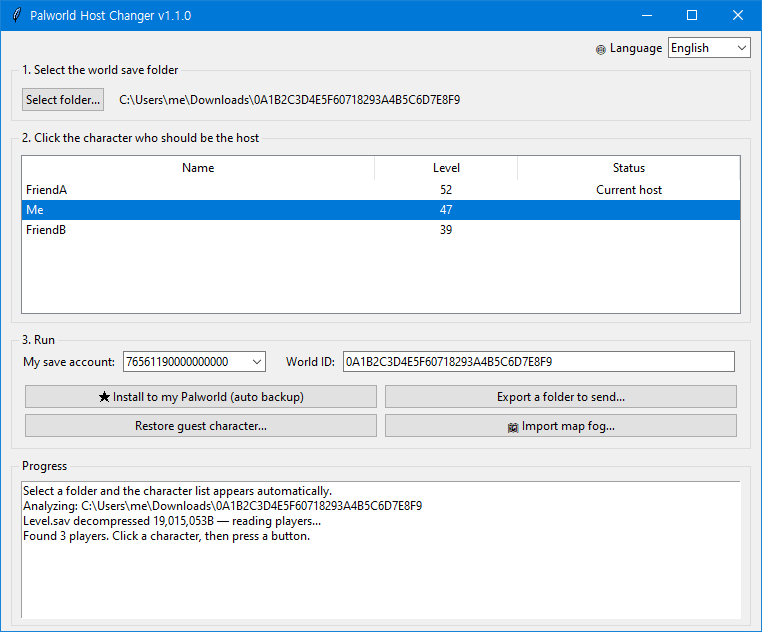

# Palworld Host Changer — change the host of a co-op world

**Your co-op host quit, got busy, or their PC died? Take the world over with _your own_ character.**
Pals, bases, guilds and items come with you. Free, open source, Windows, no install.

[](https://github.com/YohanSong/palworld-host-changer/releases/latest)
[](https://github.com/YohanSong/palworld-host-changer/releases)
[](#compatibility)
[](https://www.virustotal.com/gui/file/d6068399c5c9811226f821ee71c3b1340e80b9d2d3a014914e36d84f20c4675a)
[](LICENSE)

**English** | [한국어](docs/README.ko.md) | [简体中文](docs/README.zh.md) | [日本語](docs/README.ja.md) — the app itself switches between all four languages.



> Unofficial fan tool, not affiliated with Pocketpair. Back up your saves.

## Download

[**Latest release**](https://github.com/YohanSong/palworld-host-changer/releases/latest) → `PalworldHostChanger_v<version>.zip` → unzip → double-click **`PalworldHostChanger.bat`**.
No Python install needed: the official, PSF-signed Python runtime is bundled in `runtime\`, and the app itself is plain readable source in `app\`.
Step-by-step Steam guides: [English](https://steamcommunity.com/sharedfiles/filedetails/?id=3810358786) · [简体中文](https://steamcommunity.com/sharedfiles/filedetails/?id=3845111756) · [日本語](https://steamcommunity.com/sharedfiles/filedetails/?id=3845113994)

## What it fixes

| Problem | Feature |
|---|---|
| The host stopped playing, so nobody can load the world | **Change host** — click any character and make them the host. Pals, bases, guilds and items follow. |
| You copied the host's save and now play as *their* character | **Change host** — moves *your* character into the host slot. |
| A friend joins and gets the **character creation screen** | **Restore guest character** — puts their old character back. |
| The **map is black** after changing host | **Import map fog** — copy or merge explored areas from another player. |

## How to change the host

1. **Close Palworld completely.**
2. Get the whole world folder from the current host:
   `%LOCALAPPDATA%\Pal\Saved\SaveGames\<number>\<32-character world ID>\` (the folder with `Level.sav`).
3. Run `PalworldHostChanger.bat` → **Select folder** → pick that world folder. The character list appears.
4. Click the character who should be the host (usually you).
5. **★ Install to my Palworld** — installs into your own saves; an existing copy of the world is first moved to `%LOCALAPPDATA%\Pal\Saved\HostChangerBackups\` (outside the game's world list).
   To prepare a folder for someone else, use **Export** instead.
6. Start the game and check that the world shows your character's name. For the first launch, Steam offline mode is safest (Steam Cloud can bring back the old save).

**Friend gets the character creation screen?** They join once, make any character and play a minute. Then the host runs **Restore guest character**: ① their old character, ② the new Lv1 one.

**Map is black?** Get `LocalData.sav` (inside the world folder) from someone who explored a lot → **Import map fog** → *Merge* keeps both explorations.

## Why naive host fixes empty your palbox

<details>
<summary>Palworld 1.0 save format notes</summary>

- The host is always player UID `00000000000000000000000000000001` (`001`). Whoever opens the save takes that slot.
- **Pals are keyed by `001` too** (a host-slot sentinel in `CharacterSaveParameterMap`; the real owner is in `OwnerPlayerUId`). Rewriting every `001` breaks every pal key → empty palboxes. This tool only swaps entries flagged `IsPlayer`.
- Guild admin/member UIDs and player handles inside `GroupSaveDataMap` → `RawData` must follow the swap, or the new host gets absorbed into the old host's guild and the base looks gone. 1.0 guild entries end with a fixed trailer after the member list.
- Player `.sav` files: the UID inside must match the file name.
- Guest UIDs are fixed per Steam account but only appear after the first join; they can't be computed from a SteamID.
- Explored map data lives in each PC's own `LocalData.sav` (`WorldMapUISaveDataMap` → `MaskTextureData`), not in the world save.
- 1.0 saves are Oodle Kraken (`PlM1`), decompressed with [ooz](https://github.com/powzix/ooz); the tool writes zlib (`PlZ1`), which the game loads and re-saves in its own format.
- Swapping the host and swapping back gives byte-identical saves (decompressed). `python scripts\selftest.py <world folder>` checks this on a copy of any save.

</details>

## Compatibility

- Co-op (invite code) worlds. Not a dedicated-server migration tool.
- **Palworld v1.0.5 (current)**: self-test passed on a real v1.0.5 save (Nov 2026) — host change, change back byte-identical, export.
- Palworld v1.0.3: used on a 4-player world — two host changes, a guest restore and a map restore, all confirmed in game.
- If a future patch breaks something, please [open an issue](https://github.com/YohanSong/palworld-host-changer/issues).
- Windows 10/11.

## FAQ

**How do I change the host in Palworld co-op?** Use the steps above: the new host's character is moved into the host slot (UID 001).
**Can I give my co-op world to a friend?** Yes — **Export** with your friend's character selected, send the folder, they put it in their `SaveGames\<number>\`.
**Why did my pals disappear after moving the save?** Pal keys share the host UID; tools that replace it everywhere lose them. This one doesn't.
**Does it work after the 1.0 release? Older host-fix tools don't.** Yes — 1.0 saves are Oodle-compressed (`PlM1`), which older tools can't read; this one decompresses them directly. Checked on v1.0.5.
**My friend gets the character creation screen after the host change.** Use **Restore guest character**.
**Is this for dedicated servers?** No, co-op (invite code) worlds only.
**Is the download safe?** Source is in this repo, the release ships the signed Python runtime + `.py` files, and the zip scans clean on VirusTotal. A single PyInstaller `.exe` was dropped because Microsoft Defender falsely flags those (`Wacatac!ml`).
**Only open saves from people you trust** — the Oodle decoder is not hardened against malicious files.

## Run from source / build

```bat
pip install -r requirements.txt
python src\host_changer_gui.pyw
```

- Release zip: `python scripts\build_portable.py` (bundles the running official Windows CPython; built with 3.14.5).
- Self-test on a copy of a real save: `python scripts\selftest.py "<world folder>"`.
- Rebuild `src\ooz.dll`: `third_party\ooz\build_ooz_dll.bat` (Visual Studio C++; upstream sources unmodified).
- Translations live in `src\lang.py` — PRs for more languages are welcome.

## License / credits

GPL-3.0-or-later ([LICENSE](LICENSE)); bundled components in [THIRD_PARTY_NOTICES.md](THIRD_PARTY_NOTICES.md).
[powzix/ooz](https://github.com/powzix/ooz) (Oodle decompression, GPL-3.0+), [cheahjs/palworld-save-tools](https://github.com/cheahjs/palworld-save-tools) (GVAS, MIT), and [xNul/palworld-host-save-fix](https://github.com/xNul/palworld-host-save-fix) for the original idea. Palworld is a trademark of Pocketpair, Inc.

<sub>Also searched as: palworld change host · palworld transfer co-op world · palworld host save fix 1.0 · palworld character creation screen after host change · 팰월드 호스트 변경 · 팰월드 멀티 호스트 넘기기 · 幻兽帕鲁 更换房主 · 幻兽帕鲁 存档转移 · パルワールド ホスト 変更 · パルワールド セーブ 移行</sub>
