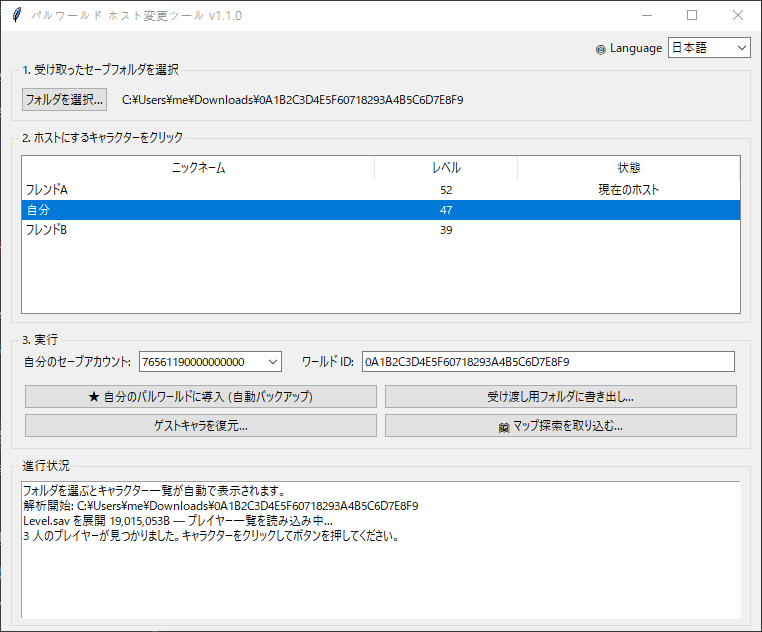

# パルワールド ホスト変更ツール (Palworld Host Changer)

**ホストが引退した、忙しくて開けない、PC が壊れた…そんなとき、そのワールドを _自分のキャラ_ で引き継げます。**
パル・拠点・ギルド・アイテムはそのまま。無料・オープンソース、Windows、インストール不要。日本語 / English / 한국어 / 简体中文 対応。

[English](../README.md) | [한국어](README.ko.md) | [简体中文](README.zh.md) | **日本語**

> 非公式のファンツールです。Pocketpair とは関係ありません。**使う前にセーブをバックアップしてください。**

## ダウンロード

[**最新リリース**](https://github.com/YohanSong/palworld-host-changer/releases/latest) → `PalworldHostChanger_v<バージョン>.zip` → **展開して** `PalworldHostChanger.bat` をダブルクリック。
Python のインストールは不要です。`runtime\` に公式の署名付き Python ランタイム、`app\` にそのまま読めるソースコードが入っています。右上の 🌐 で言語を切り替えられます。

Steam ガイド: https://steamcommunity.com/sharedfiles/filedetails/?id=3845113994

## できること

| 状況 | 機能 |
|---|---|
| ホストがやめてしまい、誰もワールドを開けない | **ホスト変更** — キャラをクリックするとその人がホストに。パル・拠点・ギルド・アイテムも一緒に移動 |
| ホストのセーブをもらって開いたら *ホストのキャラ* で入ってしまう | **ホスト変更** — 自分のキャラをホスト枠 (UID 001) に移動 |
| フレンドが入ると **キャラクター作成画面** になる | **ゲストキャラを復元** — 元のキャラを戻す |
| ホスト変更後に **マップが真っ黒** | **マップ探索を取り込む** — 他の人の探索範囲をコピー/合成 |

## 使い方 — ホスト変更

1. **パルワールドを完全に終了します。**
2. 元のホストからワールドフォルダを丸ごと受け取ります：`%LOCALAPPDATA%\Pal\Saved\SaveGames\<数字>\<32 文字のワールド ID>\`（`Level.sav` があるフォルダ）。
3. `PalworldHostChanger.bat` を起動 → **[フォルダを選択...]** → そのワールドフォルダを選ぶと、キャラクター一覧が表示されます。
4. ホストにするキャラ（普通は自分）をクリック。
5. **[★ 自分のパルワールドに導入]** — 自分のセーブにそのまま導入します。同じワールドがある場合は先に `%LOCALAPPDATA%\Pal\Saved\HostChangerBackups\` へ移して保管します（ゲームのワールド一覧には出ません）。
   他の人に渡す場合は **[受け渡し用フォルダに書き出し...]**。
6. ゲームを起動し、ワールド一覧に自分のキャラ名が出ているのを確認してから入ります。最初は Steam のオフラインモードがおすすめです（Steam クラウドで古いセーブに戻るのを防ぐため）。

**フレンドがキャラ作成画面になる？** フレンドに適当なキャラを作って 1〜2 分プレイしてもらいます（ゲスト UID は一度参加しないと作られません）→ ホストが **[ゲストキャラを復元…]**：① 元のキャラ、② 今作った Lv1 キャラ。

**マップが真っ黒？** よく探索している人の `LocalData.sav`（ワールドフォルダ内）をもらい → **[🗺 マップ探索を取り込む…]** → 合成（おすすめ）。

## 仕組み

1.0 のセーブ構造メモ

- ホストは常に UID `00000000000000000000000000000001`（001）。誰がセーブを開いても、その人が 001 になります。
- **パルのキー `PlayerUId` も 001**（ホスト枠の定数で、本当の持ち主は `OwnerPlayerUId`）。001 を一括置換するとパルボックスが空になる → このツールは `IsPlayer` のエントリだけを入れ替えます。
- ギルドデータ（`GroupSaveDataMap` → `RawData`）の管理者・メンバー UID とプレイヤーハンドルも補正します。しないと新ホストが旧ホストのギルドに吸収され、拠点が消えたように見えます。
- プレイヤー `.sav` 内部の UID とファイル名が一致しないとキャラが紐づきません。
- ゲスト UID は Steam アカウントごとに固定ですが、最初の参加後にしか現れず、SteamID から計算できません。
- マップの探索データはワールドセーブではなく、各 PC の `LocalData.sav` にあります。
- 1.0 のセーブは Oodle Kraken（`PlM1`）。[ooz](https://github.com/powzix/ooz) で展開し、zlib（`PlZ1`）で書き戻します（ゲームは正常に読み込み、次の保存で自分の形式に戻します）。
- ホストを変えて元に戻すと、すべてのセーブが元とバイト単位で一致します。`python scripts\selftest.py <ワールドフォルダ>` で任意のセーブのコピーで確認できます。

## 対応 / 注意

- 協力プレイ（招待コード）ワールド用です。専用サーバーへの移行ツールではありません。
- **最新 v1.0.5**：実際の v1.0.5 セーブでセルフテストに合格（2026-11）— ホスト変更、元に戻すとバイト一致、書き出し。
- v1.0.3：4 人ワールドでホスト変更 2 回、ゲスト復元、マップ復元をゲーム内で確認。
- 今後のアップデートで問題があれば [Issue](https://github.com/YohanSong/palworld-host-changer/issues) へ。
- 信頼できる人のセーブだけを開いてください。
- zip の中から直接起動せず、展開してから起動してください。
- exe ではない理由：PyInstaller の exe は Windows Defender に `Wacatac!ml` と誤検知されるため、署名付きの公式ランタイム + ソースで配布しています → [VirusTotal 検出 0](https://www.virustotal.com/gui/file/d6068399c5c9811226f821ee71c3b1340e80b9d2d3a014914e36d84f20c4675a)。

## ライセンス / クレジット

GPL-3.0-or-later。[powzix/ooz](https://github.com/powzix/ooz)、[cheahjs/palworld-save-tools](https://github.com/cheahjs/palworld-save-tools)、[xNul/palworld-host-save-fix](https://github.com/xNul/palworld-host-save-fix)。Palworld は Pocketpair, Inc. の商標です。
