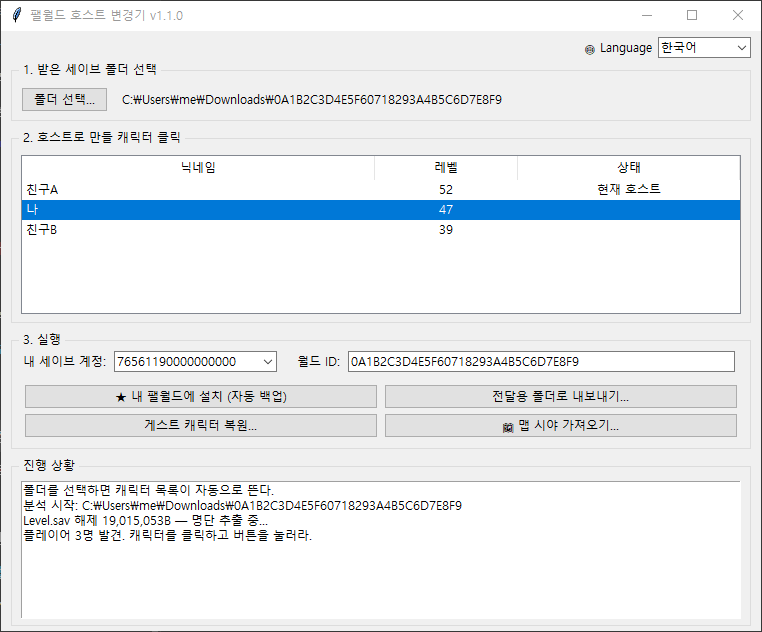

# 팰월드 호스트 변경기 — 멀티(co-op) 월드 호스트 바꾸기

**친구가 서버(월드)를 못 열어줄 때, 그 월드를 _내 캐릭터로_ 이어받는다.**
팰·거점·길드·아이템 그대로. 무료·오픈소스, 설치 없음. 한국어/English/中文/日本語 지원.

**정식 출시(1.0) 이후 세이브 지원** — 1.0부터 바뀐 Oodle 압축(`PlM1`) 세이브를 직접 풀어서 처리한다. 예전 호스트 변경 툴이 1.0에서 안 될 때 쓰면 된다.

[English](../README.md) | **한국어** | [简体中文](README.zh.md) | [日本語](README.ja.md)



> 비공식 팬 도구. Pocketpair와 무관. **쓰기 전에 세이브 백업.**

## 다운로드

[**최신 릴리스**](https://github.com/YohanSong/palworld-host-changer/releases/latest) → `PalworldHostChanger_v<버전>.zip` → **압축 풀고** `PalworldHostChanger.bat` 더블클릭.
파이썬 설치 필요 없음 — 공식 파이썬 런타임(PSF 서명)이 `runtime\`에, 도구 소스(.py)가 `app\`에 그대로 들어있다. 오른쪽 위 🌐에서 언어 변경.

## 이럴 때 쓴다

| 상황 | 기능 |
|---|---|
| 호스트 하던 친구가 접었거나 바빠서 월드를 못 연다 | **호스트 변경** — 캐릭터 클릭하면 그 사람이 호스트. 팰·거점·길드·아이템이 따라감 |
| 호스트 세이브를 받아서 열었더니 *그 사람 캐릭*으로 들어가짐 | **호스트 변경** — 내 캐릭터를 호스트 자리(001)로 옮김 |
| 친구가 접속했더니 **캐릭터 생성창**이 뜸 | **게스트 캐릭터 복원** — 예전 캐릭을 되살림 |
| 호스트 바꿨더니 **지도가 까맘** | **맵 시야 가져오기** — 남의 탐험 시야를 복사/합치기 |

## 사용법 — 호스트 변경

1. **팰월드를 완전히 끈다.**
2. 기존 호스트에게 월드 폴더를 통째로 받는다: `%LOCALAPPDATA%\Pal\Saved\SaveGames\<숫자>\<32자리 월드 ID>\` (`Level.sav` 있는 폴더)
3. `PalworldHostChanger.bat` 실행 → **[폴더 선택...]** → 받은 월드 폴더. 캐릭터 목록이 뜬다.
4. 호스트가 될 캐릭터(보통 나) 클릭.
5. **[★ 내 팰월드에 설치]** — 내 세이브에 바로 설치. 같은 월드가 있으면 먼저 `%LOCALAPPDATA%\Pal\Saved\HostChangerBackups\`로 옮겨 보관(게임 월드 목록에 안 뜸).
   남의 PC에 넣을 거면 **[전달용 폴더로 내보내기...]**.
6. 게임 켜서 월드 선택창에 내 캐릭 이름이 뜨는지 확인 후 진입. 처음엔 Steam 오프라인 모드 권장(클라우드가 옛 세이브로 덮어쓰는 것 방지).

**캐릭터 생성창 뜬 친구** → 그 친구가 아무 캐릭이나 만들어 1~2분 플레이(게스트 UID는 한 번 접속해야 생김) → 호스트가 **[게스트 캐릭터 복원…]**: ① 예전 캐릭, ② 방금 만든 Lv1 캐릭.

**지도가 까맘** → 많이 탐험한 사람의 `LocalData.sav`(월드 폴더 안)를 받아 **[🗺 맵 시야 가져오기…]** → 합치기(권장).

## 자주 묻는 질문

**Q. 팰월드 멀티 호스트를 바꿀 수 있나? 친구 월드를 내가 이어서 할 수 있나?**
된다. 친구에게 월드 폴더를 받아서 이 도구로 내 캐릭터를 호스트로 바꾸면, 내 PC에서 내 캐릭터로 그 월드를 연다.

**Q. 세이브만 복사하면 왜 남의 캐릭터로 들어가나?**
co-op 월드의 호스트 자리는 항상 UID 001이라서다. 아래 [동작 원리](#동작-원리) 참고.

**Q. 정식 출시(1.0) 이후에도 되나? 예전 툴은 안 되던데.**
된다. 1.0 세이브는 Oodle(`PlM1`)로 압축돼 예전 툴이 못 읽는다. 최신 v1.0.5 세이브로 검증했다.

**Q. 호스트를 바꾸면 팰·거점·길드가 날아가나?**
아니다. 팰 키와 길드 데이터까지 같이 보정해서 그대로 따라온다.

**Q. 호스트 바꾼 뒤 친구가 들어오니 캐릭터 생성창이 뜬다.**
**[게스트 캐릭터 복원…]**을 쓴다(위 사용법 참고).

**Q. 호스트 바꾼 뒤 지도가 까맣다.**
**[🗺 맵 시야 가져오기…]**를 쓴다.

**Q. 전용 서버(dedicated server)로 옮기는 툴인가?**
아니다. co-op(초대 코드) 월드 전용이다.

## 동작 원리

<details>
<summary>1.0 세이브 구조 메모</summary>

- 호스트는 항상 UID `00000000000000000000000000000001`(001). 누가 열든 그 사람이 001이 된다.
- **팰의 키 `PlayerUId`도 001**(호스트 슬롯 상수, 실제 주인은 `OwnerPlayerUId`). 001을 일괄 치환하면 팰박스가 빈다 → `IsPlayer` 엔트리만 교환.
- 길드(`GroupSaveDataMap` → `RawData`)의 admin·멤버 UID·플레이어 핸들도 보정. 안 하면 옛 호스트 길드로 흡수돼 거점·팰이 사라진 것처럼 보인다.
- 플레이어 `.sav` 내부 UID와 파일명이 일치해야 캐릭터가 붙는다.
- 게스트 UID는 스팀 계정마다 고정이지만 첫 접속 후에만 생긴다(스팀ID로 계산 불가).
- 탐험 시야는 각자 PC의 `LocalData.sav`에 있다.
- 1.0 세이브는 Oodle Kraken(`PlM1`) — [ooz](https://github.com/powzix/ooz)로 해제, zlib(`PlZ1`)로 저장(게임이 정상 로드 후 자기 포맷으로 다시 저장).
- 호스트를 바꿨다 되돌리면 모든 세이브가 원본과 바이트 일치. `python scripts\selftest.py <월드 폴더>`로 아무 세이브 사본에서 확인 가능.

</details>

## 호환성 / 주의

- co-op(초대 코드) 월드용. 전용 서버 이관 도구 아님.
- **최신 v1.0.5**: 실제 v1.0.5 세이브로 자체 검증 통과(2026-11) — 호스트 변경, 되돌리면 바이트 일치, 내보내기.
- v1.0.3: 4인 월드에서 호스트 2회 이관 + 캐릭 복원 + 맵 복원까지 게임에서 확인.
- 이후 패치에서 문제 생기면 [Issues](https://github.com/YohanSong/palworld-host-changer/issues)로.
- 믿을 수 있는 사람의 세이브만 열 것(Oodle 해제기는 악성 파일 대비가 없다).
- zip 안에서 바로 실행하지 말고 압축 푼 뒤 실행. 백신 "보호된 폴더" 안에선 막힐 수 있다.
- exe가 아닌 이유: PyInstaller exe는 윈도우 디펜더가 `Wacatac!ml`로 오탐한다. 서명된 공식 런타임 + 소스로 배포 → [VirusTotal 0 탐지](https://www.virustotal.com/gui/file/d6068399c5c9811226f821ee71c3b1340e80b9d2d3a014914e36d84f20c4675a).

## 소스에서 실행 / 빌드

```bat
pip install -r requirements.txt
python src\host_changer_gui.pyw
```

배포 zip: `python scripts\build_portable.py` · 자체 검증: `python scripts\selftest.py "<월드 폴더>"` · `ooz.dll` 재빌드: `third_party\ooz\build_ooz_dll.bat` · 번역: `src\lang.py`

## 라이선스 / 크레딧

GPL-3.0-or-later. [powzix/ooz](https://github.com/powzix/ooz), [cheahjs/palworld-save-tools](https://github.com/cheahjs/palworld-save-tools), [xNul/palworld-host-save-fix](https://github.com/xNul/palworld-host-save-fix). Palworld는 Pocketpair, Inc.의 상표.
