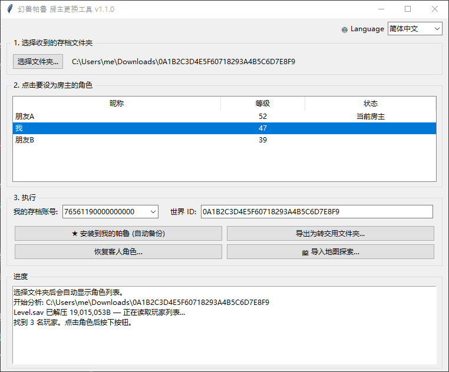

# 幻兽帕鲁 房主更换工具 (Palworld Host Changer)

**房主不玩了、没空开服、或者电脑坏了？用 _你自己的角色_ 接手这个联机世界。**
帕鲁、据点、公会、物品全部保留。免费开源，Windows，无需安装。支持 简体中文 / English / 한국어 / 日本語。

[English](../README.md) | [한국어](README.ko.md) | **简体中文** | [日本語](README.ja.md)

> 非官方粉丝工具，与 Pocketpair 无关。**使用前请备份存档。**

## 下载

[**最新版本**](https://github.com/YohanSong/palworld-host-changer/releases/latest) → `PalworldHostChanger_v<版本>.zip` → **解压** → 双击 `PalworldHostChanger.bat`。
无需安装 Python：`runtime\` 内附带官方签名的 Python 运行环境，`app\` 内是可直接阅读的源代码。右上角 🌐 切换语言。

Steam 图文教程: https://steamcommunity.com/sharedfiles/filedetails/?id=3845111756

## 能解决什么

| 情况 | 功能 |
|---|---|
| 房主不玩了，没人能打开这个世界 | **更换房主** — 点击任意角色即可设为房主，帕鲁、据点、公会、物品跟随角色 |
| 拿到房主的存档打开后，进去的是 *房主的角色* | **更换房主** — 把你的角色移到房主位置 (UID 001) |
| 朋友加入时出现 **创建角色界面** | **恢复客人角色** — 找回原来的角色 |
| 更换房主后 **地图变黑** | **导入地图探索** — 复制/合并别人的探索进度 |

## 使用方法 — 更换房主

1. **完全关闭幻兽帕鲁。**
2. 从原房主那里拿到整个世界文件夹：`%LOCALAPPDATA%\Pal\Saved\SaveGames\<数字>\<32 位世界 ID>\`（包含 `Level.sav` 的文件夹）。
3. 运行 `PalworldHostChanger.bat` → **[选择文件夹...]** → 选择该世界文件夹，角色列表会自动显示。
4. 点击要成为房主的角色（通常是你自己）。
5. **[★ 安装到我的帕鲁]** — 直接安装到你的存档；如果已有同一世界，会先移到 `%LOCALAPPDATA%\Pal\Saved\HostChangerBackups\` 备份（不会出现在游戏的世界列表中）。
   要给别人用，请选 **[导出为转交用文件夹...]**。
6. 启动游戏，确认世界列表显示你的角色名后再进入。第一次建议用 Steam 离线模式（避免 Steam 云把旧存档同步回来）。

**朋友出现创建角色界面？** 让朋友随便创建一个角色玩 1~2 分钟（客人 UID 要加入一次才会生成）→ 房主使用 **[恢复客人角色…]**：① 原来的角色，② 刚创建的 Lv1 角色。

**地图变黑？** 向探索较多的人要 `LocalData.sav`（在世界文件夹里）→ **[🗺 导入地图探索…]** → 选择 合并（推荐）。

## 原理

1.0 存档结构说明

- 房主永远是 UID `00000000000000000000000000000001`（001），谁打开存档谁就占用这个位置。
- **帕鲁的键 `PlayerUId` 也是 001**（房主位常量，真正的主人在 `OwnerPlayerUId`）。把 001 全部替换会让帕鲁箱变空 → 本工具只交换带 `IsPlayer` 的条目。
- 公会数据（`GroupSaveDataMap` → `RawData`）中的管理员/成员 UID 和玩家句柄也会同步修正，否则新房主会被并入旧房主的公会，据点看起来像消失了。
- 玩家 `.sav` 内部的 UID 必须与文件名一致，角色才能绑定。
- 客人 UID 按 Steam 账号固定，但只有第一次加入后才会出现，无法从 SteamID 推算。
- 地图探索数据在每台电脑自己的 `LocalData.sav` 中，不在世界存档里。
- 1.0 存档使用 Oodle Kraken（`PlM1`）压缩，用 [ooz](https://github.com/powzix/ooz) 解压，写回为 zlib（`PlZ1`），游戏可正常读取并以自身格式重新保存。
- 更换房主后再换回来，所有存档与原文件逐字节一致。可用 `python scripts\selftest.py <世界文件夹>` 在任意存档副本上验证。

## 兼容性 / 注意

- 适用于联机（邀请码）世界，不是专用服务器迁移工具。
- **最新 v1.0.5**：已用真实的 v1.0.5 存档通过自检（2026-11）— 更换房主、换回后逐字节一致、导出。
- v1.0.3：在 4 人世界中两次更换房主、恢复客人角色、恢复地图，均已在游戏中确认。
- 今后的更新如有问题请提交 [Issue](https://github.com/YohanSong/palworld-host-changer/issues)。
- 只打开你信任的人发来的存档。
- 请解压后再运行，不要在压缩包内直接运行。
- 为什么不是 exe：PyInstaller 打包的 exe 会被 Windows Defender 误报为 `Wacatac!ml`，所以发布签名的官方运行环境 + 源代码 → [VirusTotal 0 检出](https://www.virustotal.com/gui/file/d6068399c5c9811226f821ee71c3b1340e80b9d2d3a014914e36d84f20c4675a)。

## 许可 / 致谢

GPL-3.0-or-later。[powzix/ooz](https://github.com/powzix/ooz)、[cheahjs/palworld-save-tools](https://github.com/cheahjs/palworld-save-tools)、[xNul/palworld-host-save-fix](https://github.com/xNul/palworld-host-save-fix)。Palworld 是 Pocketpair, Inc. 的商标。
